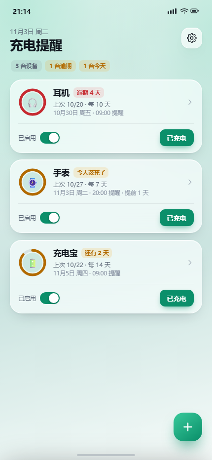
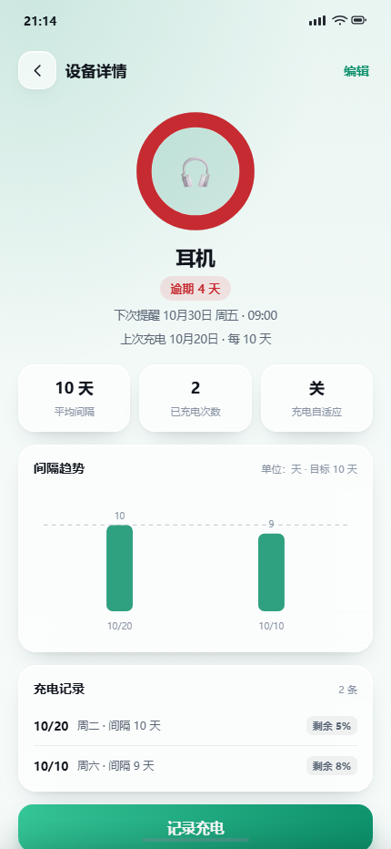
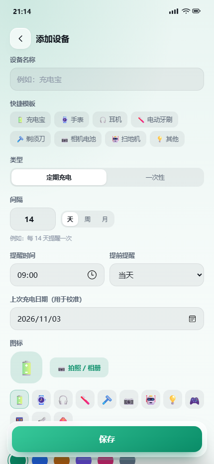
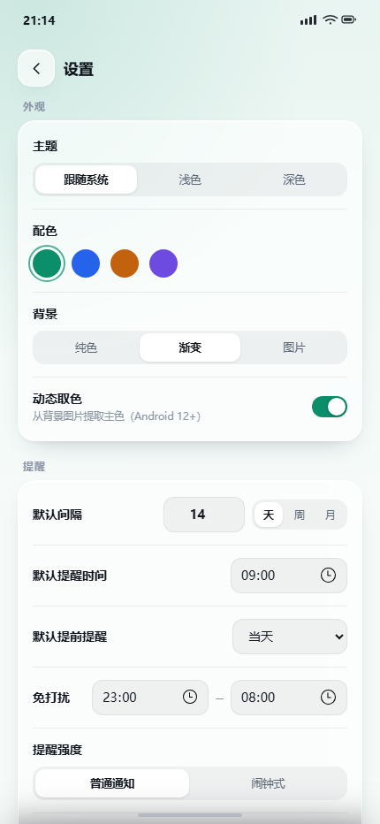
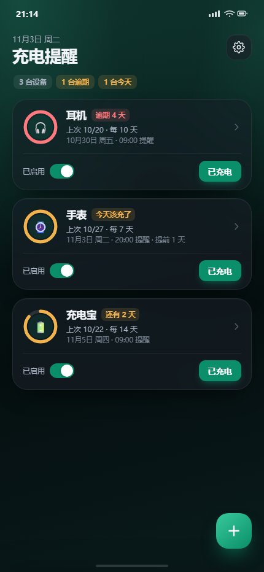
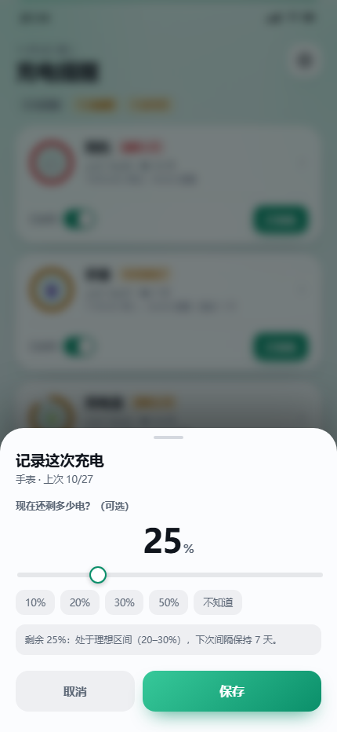

<div align="center">



# 充电提醒 · ChargeReminder

给「用一阵子就该充一次电」的东西做倒计时和提醒的 Android App。

充电宝 · 手表 · 耳机 · 电动牙刷 · 剃须刀 · 相机电池 · 扫地机……

**纯本地 · 不联网 · 不常驻后台 · Kotlin + Jetpack Compose**

[](LICENSE)
[-3DDC84.svg?logo=android&logoColor=white)](docs/build.md#环境要求)
[](docs/build.md#版本一览)
[](docs/build.md#版本一览)

</div>

---

## 这是什么

不是电池监控工具，而是一个**带倒计时的设备充电清单**：

```
上次充电时间 + 间隔天数 = 该充电的日期
到提醒日（可提前 N 天）→ 系统闹钟唤醒 App → 发一条带按钮的通知
点「已充电」→ 记录今天 → 从今天重新计算下一次
```

解决的是很具体的一个问题：充电宝、手表、耳机这些设备放久了会亏电，
但它们的充电周期各不相同，靠脑子记不住。这个 App 只做一件事——
**到点告诉你该给哪台设备充电了**，然后由你自己决定什么时候充。

它从零自研：没有 Fork MedTimer / reReminder 等开源项目，也没有复制它们的代码，
但提醒机制的写法参考了这些项目的实践（见 [开源基座调研](docs/research.md)）。

## 功能

**首页**

- 卡片流 + 进度环 + 剩余天数 + 上次充电日期 + 下次提醒时间
- 按紧急程度排序：逾期 → 今天 → 临近 → 正常 → 已停用
- 一键「已充电」，记录后自动重排下一次提醒
- 启用 / 停用开关，停用后置灰且不再排闹钟

**设备**

- 定期（天 / 周 / 月）与一次性任务
- 8 个快捷模板：充电宝 / 手表 / 耳机 / 电动牙刷 / 剃须刀 / 相机电池 / 扫地机 / 其他
- emoji 图标，或拍照 / 相册选图当图标；自定义颜色
- 提醒时间、提前 1 / 3 天提醒、备注

**详情与历史**

- 平均间隔、充电次数、间隔趋势柱状图
- 充电记录，可附「剩余电量」
- 编辑、删除（二次确认）

**充电自适应**

记录充电时可选填剩余电量，按**实际耗电速度**推算新间隔，而不是简单地「电量低就缩短」：

```
单日耗电 = (100 - 剩余电量) / 实际用了几天
到 20% 的天数 = 80 / 单日耗电
新间隔 = 这个天数（单次最多相对当前变化 ±30%）
```

提前充电时电量天然很高，这种算法不会把它误判成「还能用更久」。

**外观**

- 跟随系统 / 浅色 / 深色
- 4 套预设配色 + Android 12 动态取色
- 背景：纯色 / 渐变 / 相册图片（可调模糊与暗化，跟随深浅色自动调暗）
- 半透明卡片 + 大圆角 + 细描边

**设置**

- 默认间隔、默认提醒时间、默认提前提醒
- 免打扰时段、提醒强度（普通通知 / 闹钟式）、逾期每天提醒
- 权限自检（通知 / 精确闹钟 / 电池优化）+ 发送测试通知
- JSON 导出 / 导入、清空数据、隐私说明

## 截图

| 首页 | 设备详情 | 添加设备 |
| :---: | :---: | :---: |
|  |  |  |
| **设置** | **深色模式** | **记录充电** |
|  |  |  |

## 提醒是怎么工作的

核心不到 100 行，关键是**不常驻后台**：

- 每台设备用 `AlarmManager.setExactAndAllowWhileIdle(RTC_WAKEUP)` 排一个精确闹钟，
  `PendingIntent` 的 `requestCode` 用设备 id 区分
- 到点由系统发广播唤醒 `ReminderReceiver`：发通知 → 重新排下一次
- 通知上的【已充电】【推迟 3 天】走 `BroadcastReceiver`，不在通知里起 Activity
  （Android 12+ 禁止 notification trampoline）
- 开机、改时间、改时区、应用更新（`BOOT_COMPLETED` / `TIME_SET` / `TIMEZONE_CHANGED` / `MY_PACKAGE_REPLACED`）后全量重排
- 没有精确闹钟权限时自动退化为 `setAndAllowWhileIdle`，并在设置页提供权限自检

需要申请的权限：通知（Android 13+ 运行时）、精确闹钟（Android 12+，14+ 默认不授予）、
忽略电池优化、开机广播。国产 ROM 还需手动允许「自启动」并把省电策略设为「无限制」。

## 快速开始

### 环境要求

| 项 | 版本 |
|---|---|
| Android Studio | 2026.2.2（Rabbit 2）及以上 |
| JDK | 25（Studio 自带的 jbr 即可） |
| Android SDK Platform | 37.2（Android 17.x） |
| Gradle | 9.7.1（由 wrapper 自动下载，已配腾讯镜像） |
| 测试设备 | Android 8.0（API 26）及以上，targetSdk 36 |

更细的环境说明、Gradle 下载慢 / SDK 缺失等处理方式见 [构建说明](docs/build.md)。

### 构建

```bash
# 换成你自己的仓库地址
git clone https://github.com/your-name/charge-reminder.git
```

1. Android Studio → `File → Open`，选择 **`android-app/`** 目录（不是仓库根目录）
2. 等 Gradle Sync 完成（首次会下载 Gradle 与依赖，已配阿里云 Maven 镜像）
3. 连真机 → **Run**

> 仓库没有附带 `gradle-wrapper.jar` / `gradlew`，直接用 Android Studio 的 Gradle 集成即可；
> 需要命令行构建时的做法见 [docs/build.md](docs/build.md#没有-gradlew-怎么办)。

### 第一次运行

1. 允许**通知权限**
2. 进入 `设置 → 权限自检`：开启**精确闹钟**、**电池优化**白名单
3. 小米 / 红米 / 华为 / 荣耀 / OPPO / vivo：再到系统设置里允许**自启动**、省电策略设为**无限制**
4. 回首页点右下角 `＋` 添加设备

### 2 分钟验证提醒是否真的会响

- 间隔设 `1 天`
- 上次充电日期选 `昨天`
- 提醒时间设成「当前时间 + 2 分钟」
- 保存后等通知；在通知上点【已充电】，首页应立刻变成「还有 N 天」

## 目录结构

```text
.
├── android-app/                 Android 工程（Kotlin + Jetpack Compose）
│   ├── app/src/main/java/       19 个 Kotlin 文件，约 3,200 行
│   │   └── com/example/chargereminder/
│   │       ├── data/            数据模型、倒计时 / 自适应计算、JSON 仓库
│   │       ├── alarm/           精确闹钟、到点广播、开机重排
│   │       ├── notify/          通知渠道与通知按钮
│   │       ├── util/            图片压缩、日期格式化
│   │       └── ui/              主题、组件、首页 / 详情 / 编辑 / 设置 / 记录弹层
│   ├── gradle/                  版本目录（libs.versions.toml）与 wrapper 配置
│   └── verify-gradle.ps1        可选：校验本地 Gradle 离线包完整性
├── prototype/                   HTML 可点击原型（双击 index.html 打开）
├── docs/
│   ├── screenshots/             截图
│   ├── research.md              开源基座调研与落地方案（2026-11-01）
│   ├── requirements.md          需求清单（定稿）
│   ├── retrospective.md         开发复盘：踩坑与可复用清单
│   └── build.md                 构建、环境、权限与排错
├── CHANGELOG.md
├── LICENSE
└── README.md
```

## 技术栈（刻意保持简单）

| 决策 | 选择 | 原因 |
|---|---|---|
| 语言 / UI | Kotlin 2.4.20 + Jetpack Compose（BOM 2026.09.00） | 单 Activity，无 Fragment、无 XML 布局 |
| 构建 | AGP 9.5.0 + Gradle 9.7.1，`compileSdk 37.2` / `minSdk 26` / `targetSdk 36` | 版本组合取自同代活跃开源项目，不靠猜 |
| 数据库 | 不用 Room，一个 `data.json` | 设备数量个位数，省掉 KSP 与迁移 |
| 图片加载 | 不用 Coil，手写 Bitmap 采样 | 只有设备图标和背景两处 |
| 导航 | 不用 navigation-compose，`sealed interface Screen` + `when` | 4 个页面，返回栈就一层 |
| 依赖注入 | 不用 Hilt，`object Repo` | 单模块 |
| 状态 | `mutableStateOf` + Compose 自动重组 | 不需要 Flow / ViewModel |
| 提醒 | `AlarmManager` + `BroadcastReceiver` | 零常驻、不耗电 |

## 文档

| 文档 | 内容 |
|---|---|
| [docs/research.md](docs/research.md) | 立项调研：为什么不直接用现成开源项目、可改造基座横向对比、许可证避坑 |
| [docs/requirements.md](docs/requirements.md) | 需求清单定稿：竞品试装结论、设备与周期、首页 / 提醒 / 外观细则、验收标准 |
| [docs/retrospective.md](docs/retrospective.md) | 开发复盘：五个阶段、10 个坑的完整记录、新 Android 工程启动清单 |
| [docs/build.md](docs/build.md) | 构建与环境：Gradle 离线方案、compileSdk 排错、国产 ROM 适配、2 分钟自测 |
| [prototype/README.md](prototype/README.md) | HTML 原型说明：可以点哪些东西、哪些是「假的」 |

## 隐私

- **没有 `INTERNET` 权限**，App 不联网、不上传任何数据
- 没有账号、广告、埋点、统计
- 全部数据保存在应用私有目录：
  - `/data/data/com.example.chargereminder/files/data.json`
  - 设备照片在 `filesDir/photos`
- 卸载会丢数据，建议偶尔在 `设置 → 数据` 里导出 JSON 备份

## 已知限制

- 没有桌面小组件（可考虑用 Glance 补一个 2×2）
- 导出 JSON 不含照片
- 动态取色取的是系统壁纸颜色，不是从自定义背景图里提取主色
- 包名仍是 `com.example.chargereminder`，如需上架请改成自己的域名
- 只有中文，没有多语言
- 仓库不带 `gradlew` / `gradle-wrapper.jar`，命令行构建需自行生成（见构建说明）

## 协议

[MIT](LICENSE)。欢迎拿去改成自己的版本，保留版权声明即可。

本项目为从零编写的原创实现；调研阶段参考的开源项目（MedTimer、reReminder、MainTask、
Tasks.org、Table Habit、Loop 等）只用于产品与实现思路的对比，**未复制其源代码**。
各项目许可证见 [调研文档第 7 节](docs/research.md#7-许可证与发布避坑)。
